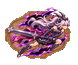
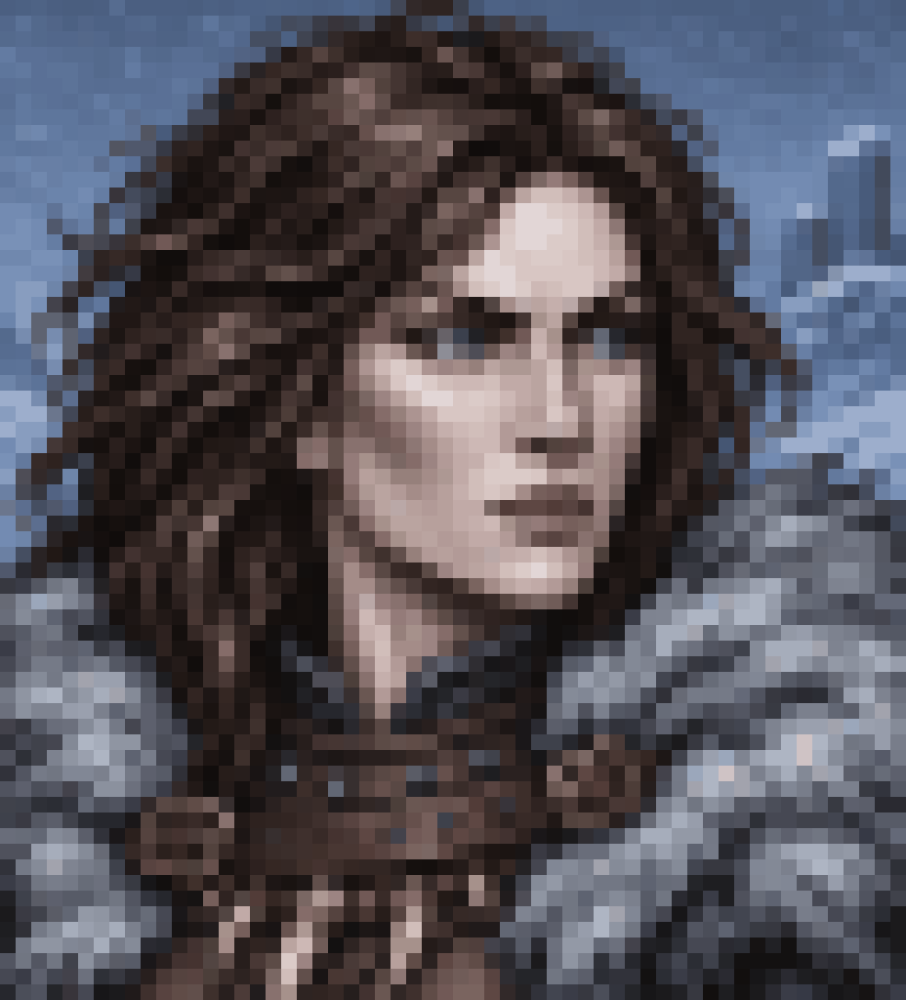
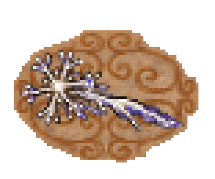
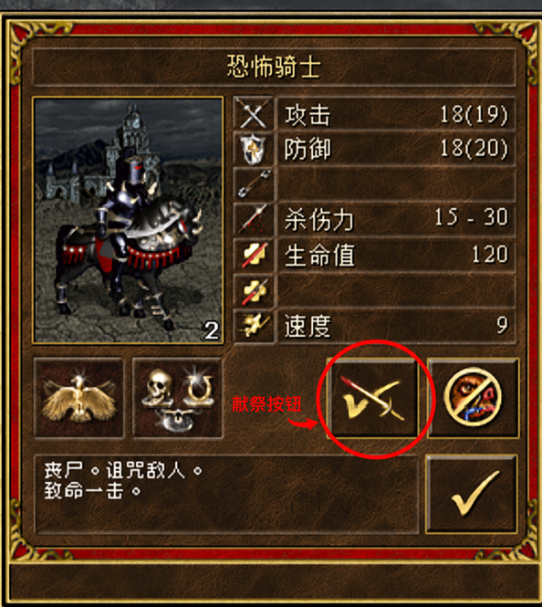
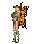
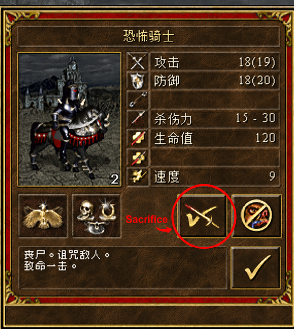

<h1 align="center">英雄无敌3-HOTA-新英雄特长开发专栏<br>Heroes of Might and Magic III: Horn of the Abyss — New Hero Specialty Development</h1>

<p align="center"><sub>点击左侧三角图标，展开对应语言或版权声明的详细内容。<br>Click the triangle icon on the left to expand your preferred language or the copyright notice.</sub></p>

<p align="center">本项目专注于《英雄无敌 III：深渊号角》（HotA）1.8.0 版本的英雄新特长开发、机制研究与实机验证。<br>This project focuses on developing, researching, and playtesting new hero specialties for Heroes of Might and Magic III: Horn of the Abyss (HotA) 1.8.0.</p>

<p align="center"><sub><a href="docs/EXPERIENCE_ACCESS.md">开发经验资料访问与借阅申请 / Development Experience Access Request</a></sub></p>

<p align="center"><strong>当前版本 / Latest：1.8</strong> · <strong>历史版本 / History：</strong><a href="https://github.com/TonyUB/hota-hero-specialty-patch/blob/v1.73/README.md">1.73</a> · <a href="https://github.com/TonyUB/hota-hero-specialty-patch/blob/v1.71/README.md">1.71</a> · <a href="https://github.com/TonyUB/hota-hero-specialty-patch/blob/v1.61/README.md">1.61</a> · <a href="https://github.com/TonyUB/hota-hero-specialty-patch/blob/c128a71c34bf5cead40bd79e0adfae6cc6153eaa/README.md">1.6</a></p>

<details name="section" open>
<summary><strong>🔴 中文说明</strong></summary>

**当前版本下载：** [HOTA_NEW_HERO_V1.8.zip](https://github.com/TonyUB/hota-hero-specialty-patch/raw/refs/heads/main/Download/HOTA_NEW_HERO_V1.8.zip)&nbsp;&nbsp;&nbsp;&nbsp;**手册下载：** [HOTA_NEW_HERO_V1.8_HERO_HANDBOOK.docx](https://github.com/TonyUB/hota-hero-specialty-patch/raw/refs/heads/main/Manual/HOTA_NEW_HERO_V1.8_HERO_HANDBOOK.docx)

[全局按钮说明](docs/GLOBAL_OPTIONS.md)

## 第一大类  原创英雄

### 挽昼

<p>&nbsp;&nbsp;&nbsp;&nbsp;&nbsp;&nbsp;</p>

**英雄简介：** 当双剑相交的灭世阴影悄然笼罩恩洛斯时，三名自称“挽昼”的异界旅者穿越时空裂隙降临于此。尽管他们的装束与战法在世人眼中显得格外奇异，但其阻止毁灭降临的决心却毋庸置疑。为了改写这个世界注定崩塌的终局，三人并肩踏上了战火纷飞的征途，试图逆转恩洛斯覆灭的命运。

**英雄阵营：** 城堡阵营；替换原狮鹫特长英雄艾得力克。

**特长效果：** 挽昼——艾尔妲·挽昼、林德薇恩·挽昼和德蕾琪娜·挽昼加入英雄麾下作战。三人无法交换，其他兵种无法出战。随着英雄等级提升，三人的魔力上限提高，魔法减伤逐步提升至95%。艾尔妲与林德薇恩额外提升杀伤力，德蕾琪娜额外提升生命上限和防御力。

**初始兵力：** 1 艾尔妲·挽昼 / 1 林德薇恩·挽昼 / 1 德蕾琪娜·挽昼。

**职业：** 骑士

**四维：** 2/2/1/1

**初始技能：** 中级领导术。

#### 战斗与成长

三人均为中立 5 级兵，免疫心智魔法。1 级时各有 20 点魔力，受到的魔法伤害降低 5%。此后每升一级，魔力上限加 5，魔法减伤加 5 个百分点，19 级达到 95% 上限。

- 德蕾琪娜防御后，敌人以近战、远程、箭塔或战争机器攻击同伴时，她会移到队友附近距自己最近的合法空格，以自己的防御和减伤承受攻击。新的来袭会重新选位。若队友被围得没有落脚点，攻击仍命中原目标。法术伤害不触发援护。

- 普通攻击命中或造成负面效果时，给相应敌军附加 1 层残痕。扇形攻击逐队记录，双击逐击记录；攻击防御中的盾手或被她援护格挡的敌人也会获得残痕。残痕整场保留、无法驱散，仅供消耗。消耗残痕的技能不会补回层数。

- 三人分别保留剩余生命和魔力。胜利后，倒下的成员以 1 点生命归队；三人全灭则战败。撤退后在酒馆重新雇用时保留状态。英雄界面的兵种信息可查看剩余生命。过夜行动力按林德薇恩的 9 速计算。

- 三名本体阵亡后保留尸体。湮灭戒指、吞尸、招魔和深渊号角不能将其移除；牺牲也不能把她们当作祭品。即使对手装备湮灭戒指，仍可选中合法阵亡格复活。盾牌和大剑伸出格子的部分不占地，真正被其他部队占住的格子仍须先腾开。镜像遵循通常的消失规则。

#### 三本兵种法术书

轮到该成员行动时，点击金色指尖按钮打开她的法术书。左键施放，右键查看当前数值和费用，红色书签关闭。施法占用该成员本次行动，魔力从她自己的储备扣除。以下按书中左页从上到下、再右页从上到下排列。

**艾尔妲·挽昼** · 远程射手，近战杀伤力不减。英雄每升一级，攻击、防御、最低与最高杀伤各加 1。

| 图标 | 法术 | 消耗 | 效果 |
|:--:|---|---|---|
|  | 不灭热忱 | 16 魔力 | 按高级转世重生复活一队友军，恢复量随英雄力量提高。复活德蕾琪娜时，她立即防御并可援护。 |
|  | 以挽昼之名 | 15 魔力 | 本场战斗余下时间内，每次射击连续发出两箭。无距离或城墙惩罚，被贴身时也可射击。 |
|  | 执旌 | 12 魔力 | 为全体友军施加强化的高级祈祷。三位挽昼均为 5 级兵，攻击、防御和速度各提高 6 点。 |
|  | 重塑万象 | 每队敌军各 3 层残痕 | 每个合格的存活敌军都须有足够残痕。逐队扣层后对敌军造成相当于当前英雄末日审判的伤害，战争机器除外。 |

**林德薇恩·挽昼** · 可击中扇形区域内的所有敌军，敌人无法反击。每升一级杀伤加 10。双击时第二击也按扇形逐队结算。

| 图标 | 法术 | 消耗 | 效果 |
|:--:|---|---|---|
|  | 斩棘 | 20 魔力 | 获得持续至本场战斗结束的双击能力。先斩棘、后召出的镜像也具有双击。 |
|  | 同行 | 20 魔力 | 以高级镜像规则创造一个自身的镜像。与英雄的镜像法术共享限制，同一本体同时只能有一个镜像。 |
|  | 虚空斩进 | 20 魔力 | 先选任意合法落脚格，再选邻格敌军，穿过裂隙发动普通攻击。可越过完好城墙；落点须能近战接触目标。 |
|  | 一体同心 | 单队全部残痕，至少 4 层 | 选择一队敌军，耗尽其所有残痕并消灭整队。目标没有 4 层时无法发动。 |

**德蕾琪娜·挽昼** · 受到的物理伤害降低 40%，优先行动。每升一级，生命上限加 20，防御加 1。等待不会进入援护状态。

| 图标 | 法术 | 消耗 | 效果 |
|:--:|---|---|---|
|  | 坚守之誓 | 10 魔力 | 对自己施加中级土系护体神盾，降低近战伤害，随即进入防御并可援护。 |
|  | 希望堡垒 | 10 魔力 | 对自己施加中级气系大气神盾，降低远程伤害，随即进入防御并可援护。 |
|  | 盾牌猛击 | 目标 2 层残痕 | 在移动范围内选择可近战接触的敌人。瞬移到它身旁，击晕 2 回合，随后防御。眩晕可由治疗或驱散解除；雪怪持续 1 回合。 |
|  | 掷光 | 目标 2 层残痕 | 掷出盾牌击中一队敌军后收回，造成该部队生命上限 25% 的伤害。 |

---
### 姬嘉

<p>&nbsp;&nbsp;&nbsp;&nbsp;&nbsp;&nbsp;&nbsp;&nbsp;&nbsp;&nbsp;&nbsp;&nbsp;</p>

**英雄简介：** 作为科尔格的第三任妻子，姬嘉为了巩固自己的地位，前往沃里夺取寒冰之剑。她在混战中被塔南击败并囚禁，但她很快就利用狡黠的手腕逃脱了监禁。最终，她将寒冰之剑连同末日的阴影一起带回了野蛮人的领地。

**英雄阵营：** 棱堡阵营；替换原外交术英雄奥伊达娜。

**特长效果：** 寒冰之剑——英雄初始携带寒冰之剑，并依据所掌握的技能解锁相应的额外加成。

**初始兵力：** 20–30 狗头人 / 6–8 山羚 / 3–5 雪精灵。

**职业：** 长老

**四维：** 0/1/1/3

**初始技能：** 初级智慧术 / 初级学习能力。

**初始装备：** 寒冰之剑 / 魔法书（初始魔法为冰弹）。

#### 寒冰之剑使用说明

- 装备寒冰之剑可施放凛冬裁决。这是消耗 24 点魔法值的 4 级水系战斗魔法，冻结可受影响的敌军 3 回合。冻结单位受到首次兵种物理攻击时，伤害增加 25%，随后解除冻结。
- 姬嘉持剑时可随所学技能获得额外加成。技能及中、高级效果见[中英文英雄手册](Manual/HOTA_NEW_HERO_V1.8_HERO_HANDBOOK.docx)。
- 姬嘉持剑时，中级／高级符文术在开战时额外叠加 3／6 层符文。中级／高级气系魔法使己方部队速度 +1／+2。
- 周一酒馆自然刷新时，姬嘉只保留原有的寒冰之剑。

---
### 烬

<p>&nbsp;&nbsp;&nbsp;&nbsp;&nbsp;&nbsp;&nbsp;&nbsp;&nbsp;&nbsp;&nbsp;&nbsp;</p>

**英雄简介：** 烬原本只是一具供布拉卡达法师驱使的普通魔像，却在一场失控的炼金爆炸中意外诞生了灵智。从焦黑的工坊废墟中苏醒后，他以“烬”为名，凭着惊人的悟性钻研起造物主遗留的秘典。如今，他致力于重塑自己的同类，能将粗糙的石头人与铁人淬炼为无坚不摧的金人与钻石人。

**英雄阵营：** 塔楼阵营；替换原石人特长英雄琼斯菲尔。

**特长效果：** 傀儡——麾下四种魔像免疫减速且拥有[先制反击]特技；速度+1，石、铁魔像可升级为金或钻石魔像；每只金魔像每日产出50金币；钻石魔像受到的物理伤害降低40%；初始掌握源质重构，可永久复活己方魔像。麾下有非亡灵无生命体时，仅这些部队出战；否则全军出战。

**初始兵力：** 30–40 小妖精 / 4–5 石人 / 4–5 石人。

**职业：** 炼金术士

**四维：** 1/1/2/2

**初始技能：** 初级火系魔法 / 初级神秘术。

**初始装备：** 魔法书（初始魔法为源质重构）。

#### 傀儡使用说明

- 石、铁、金和钻石魔像可在敌方近战攻击前反击一次，并消耗本次反击机会。若先制反击击杀来袭部队，其攻击取消。
- 非亡灵无生命体包括 10 种元素、5 种魔像、两种塔楼石像鬼和工厂的四种机械兵。只要带有其中一队，其他普通部队留在场外；全军均不符合条件时，则照常出战。

---
### 瓦伦

<p>&nbsp;&nbsp;&nbsp;&nbsp;</p>

**英雄简介：** 作为埃里半人马部落中极具威望的领袖，瓦伦拒绝让自己的族人仅仅充当精灵大军的附庸。他极其了解半人马的习性与技巧，创建了独属于自己的精英半人马部队。精通射术的半人马射手与来去如风的半人马斥候，让埃里的敌人们尝尽了苦头。

**英雄阵营：** 壁垒阵营；替换原鹰眼术英雄马尔凯姆。

**特长效果：** 人马统领——半人马兵种的速度+1，且每1级增加其10%的攻击和防御（向上取整）。你可以用金币把麾下的半人马升级为首领、射手或斥候，并互相转换。

**初始兵力：** 24 半人马 / 12 半人马 / 12 半人马。

**职业：** 游侠

**四维：** 1/3/1/1

**初始技能：** 初级进攻术 / 初级箭术；无魔法书与初始法术。

#### 创作难度

★★★★（4.5 / 5）

#### 创作方向

新增两种兵种、原生三选数量升级、射击与飞行机制、完整像素动画和界面实时刷新。

#### 人马统领使用说明

- 从瓦伦麾下半人马的兵种信息窗点击原升级按钮，选择兵种和升级数量。首领、斥候、射手可以相互转换；首领与斥候互转免费，转为射手每只补10金币，射手转回首领或斥候免费且不退差价。高级人马不能转回基础半人马。
- 从左到右：半人马首领 20 金币、半人马射手 30 金币、半人马斥候 20 金币，均为每只升级费用。
- 射手基础速度 7，可射击且无距离、城墙惩罚；斥候基础速度 12，可以飞行，其余战斗数值与基础半人马一致。
- 升级优先合并同种部队，再使用第一个空位；整队转换可释放原槽位。没有可合并部队和可用空位时提示队伍已满。
- 窗口内每次升级后，金币、剩余基础兵及新部队立即更新。
- [查看完整中英文规则](docs/SPECIAL_MECHANICS.md#valen-centaur-command)

---
### 塔博克

<p>&nbsp;&nbsp;&nbsp;&nbsp;</p>

**英雄简介：** 塔博克是泰塔利亚边境一个部落的酋长。他只对沼泽深处的九头怪感兴趣。凡是由他统领的九头怪，总能在混战中给敌人留下极其惨痛的教训。

**英雄阵营：** 要塞阵营；替换原鹰眼术英雄蒂娃。

**特长效果：** 九头之主——英雄麾下的九头怪和终极九头怪获得钻地移动能力。九头怪每回合额外反击一次，终极九头怪可无限反击。

**初始兵力：** 1 九头怪。

**职业：** 驯兽师

**四维：** 0/4/1/1

**初始技能：** 初级防御术 / 初级进攻术；无魔法书与初始法术。

#### 创作难度

★★★★（4.5 / 5）

#### 创作方向

英雄限定钻地移动、分级反击机制、大小九头破土动画，以及头像与兵种说明整合。

#### 九头之主使用说明

- 钻地和额外反击仅由塔博克赋予麾下大小九头；其他英雄继续使用原生机制。
- 大小九头分别使用已验收的钻地、出土及破土效果；原鹰眼术特长已停用。
- [查看完整中英文规则](docs/SPECIAL_MECHANICS.md#tabok-lord-of-hydras)

---
### 奥蕾加

<p>&nbsp;&nbsp;&nbsp;&nbsp;&nbsp;&nbsp;&nbsp;&nbsp;&nbsp;&nbsp;&nbsp;&nbsp;&nbsp;&nbsp;&nbsp;&nbsp;&nbsp;&nbsp;&nbsp;&nbsp;</p>

**英雄简介：** 与传统的战斗法师不同，奥蕾加将全部魔法天赋都用于探索未知的宝物。当克鲁罗德的其他法师在战场上制造毁灭时，她却运用法术来透视王国的贫瘠废土。凭借独有的寻宝术，她总能从荒芜之地发掘出深埋地底的宝藏。

**英雄阵营：** 据点阵营；替换原鹰眼术英雄奥力斯。

**特长效果：** 寻宝术——英雄可以在移动后挖掘，但至少需要200点行动力。每次挖掘会随机获得一座尚未访问的方尖塔所提供的藏宝图信息，以及奖池中的一项奖励。

**初始兵力：** 20–30 大耳怪 / 5–7 恶狼骑士 / 5–6 半兽人。

**职业：** 战斗法师

**四维：** 2/1/1/1

**初始技能：** 初级智慧术 / 初级侦察术。

#### 创作难度

★★★★☆（4 / 5）

#### 创作方向

移动后挖掘、方尖塔同步、大小保底机制设计。

#### 寻宝术使用说明

- [查看奥蕾加寻宝术的完整中英文规则](docs/SPECIAL_MECHANICS.md#奥蕾加寻宝术--olega-treasure-hunt)

---
### 阿萨泽尔

<p>&nbsp;&nbsp;&nbsp;&nbsp;</p>

**英雄简介：** 在被提拔为恶魔将军之前，阿萨泽尔曾是地狱深渊中最冷酷的军械监工。在他看来，血肉注定会衰败，钢铁与烈火才是最可靠的毁灭手段。阿萨泽尔在战争机器的制造与运用上有着非凡天赋，并因此在地狱军中迅速崭露头角。经他改良的攻城器械不仅能摧毁坚固的城防，也能在野战中撕开最严密的阵线。

**英雄阵营：** 地狱阵营；替换原连珠火球英雄夏洛克斯。

**特长效果：** 战争机器——弩车、加农炮和投石车每次行动额外射击1次；胜利后修复战前拥有且被摧毁的战争机器。补给车存活时，射手、弩车和加农炮攻击力+4，补给车单次受击最多损失40%最大生命。中级及以上炮术使弩车和加农炮对部队无视50%防御；高级炮术还使其无视射程与城墙惩罚；同时掌握高级弹道术和高级炮术时，战争机器优先行动。

**初始兵力：** 4–5 地狱猎犬 / 1 弩车。

**职业：** 大魔鬼

**四维：** 2/2/1/1

**初始技能：** 初级弹道术 / 初级炮术；无魔法书与初始法术。

#### 创作难度

★★★★★（5 / 5）

#### 创作方向

战争机器行动链扩展、战后修复与动态增益、补给车伤害边界、炮术防御与距离规则、双高级技能逻辑行动优先级，以及头像、特长图集和动态说明的完整整合。

#### 战争机器使用说明

- [查看阿萨泽尔战争机器特长的完整中英文规则](docs/SPECIAL_MECHANICS.md#阿萨泽尔战争机器--azazel-war-machines)

---
### 厄瑞玻斯

<a href="assets/ui/erebus-sacrifice-window-annotated.png"></a>

<p>&nbsp;&nbsp;&nbsp;&nbsp;&nbsp;&nbsp;&nbsp;&nbsp;&nbsp;&nbsp;&nbsp;&nbsp;&nbsp;&nbsp;&nbsp;&nbsp;&nbsp;&nbsp;&nbsp;&nbsp;</p>

**特殊功能详解：**  [查看献祭的完整允许范围、禁止范围与实现边界](docs/SPECIAL_MECHANICS.md#破灭重塑--ruinous-reforging)

**英雄简介：** 厄瑞玻斯是远古时代最早诞生的纯血黑龙之一。他自愿拥抱死亡并凭借自身意志重生，成为世间第一位鬼龙之王。环绕其身的破灭之力扭曲了死灵法则，在他的威压下，普通亡灵的骨骸会崩解重组，化作令人胆寒的骨龙为他而战。

**英雄阵营：** 墓园阵营；替换原行尸英雄斯强克。

**特长效果：** 破灭重塑——允许英雄将麾下1-6级墓园兵种转化为骨龙，有龙族时，非龙单位不能参战。

**初始兵力：** 1 骨龙。

**职业：** 死亡骑士

**四维：** 1/2/2/1

**初始技能：** 中级招魂术；魔法书自带悲泣。

#### 创作难度

★★★★★（5 / 5）

#### 创作方向

兵种转换框架设计、基础生命值献祭结算、自定义按钮设计、HotA/HD 双运行路径的兼容适配。

#### 破灭重塑使用说明

- 骷髅兵和骷髅勇士每60只转化1只骨龙，自动计算最大数量，余数放入空兵槽；需要保留余数而没有空位时提示部队已满，不结算。其他兵种的等级倍率按来源兵种等级计算：1级 2.0、2级 1.8、3级 1.6、4级 1.4、5级 1.2、6级 1.0；对应生命门槛为 `240 × 等级倍率`。
- 仅能在冒险地图中厄瑞玻斯自己的英雄军队兵种信息窗使用；战斗、城镇驻军及另一名英雄的军队不能直接献祭。
- 可献祭墓园 1—6 级基础及升级兵种；骨龙、鬼龙及其他不在白名单中的生物不能献祭。
- 只读取兵种数据库基础生命值，不计算生命类宝物、血瓶、急救术或其他临时加成。
- 骨龙在原兵槽生成。骷髅兵和骷髅勇士按上述规则保留余数；其他兵种维持原有整队献祭结算。
- 结果为 0、来源不合格或取消操作时，部队保持不变。
- 厄瑞玻斯的原升级按钮已专用于献祭；如需普通城镇升级，请先把部队交给其他英雄。
- 按钮、右键说明、确认弹窗和结算均正常。
- 龙族范围与“龙之血瓶”一致：绿龙、金龙、骨龙、鬼龙、红龙、黑龙、圣龙、水晶龙、魔法龙、毒龙。
- 当军中至少存在一队龙族时，只有上述龙族能够进入战场；非龙单位仍可随身携带。获胜后未参战单位原位保留，失败、撤退或投降时不恢复。
- 当军中至少存在一队龙族时，每日陆地移动力只按龙族部队的原生速度标准计算；多队龙族仍由最慢的一队决定。后勤术、宝物、马厩、地形等修正保持原生结算。
- 军中完全没有龙族时，两项限制均不启用：全部部队正常出战，移动力按原生全军规则计算。
- 厄瑞玻斯初次登场及隔周正常刷新到酒馆时携带 1 骨龙；战败或逃跑后在当周酒馆返场时仅携带 1 骷髅兵；投降按原生规则保留全部兵力。

---
### 埃尔芙

<p>&nbsp;&nbsp;&nbsp;&nbsp;</p>

**英雄简介：** 埃尔芙是妖精一族的女王，她的名字长久以来只存在于吟游诗人的古老歌谣中。她以绝世容貌与卓越的战术才能闻名。当埃拉西亚陷入危难时，她打破避世誓言，响应元素城的召唤，亲率部众为这片大陆而战。

**英雄阵营：** 元素城阵营；替换原毁灭之光英雄阿奈尔。

**特长效果：** 仙灵——仙灵和妖精杀伤力+1，速度+1。

**初始兵力：** 25 仙灵 / 25 仙灵 / 25 仙灵。

**职业：** 位面行者

**四维：** 3/1/1/1

**初始技能：** 初级战术 / 初级进攻术。

#### 创作难度

★★★☆（3.5 / 5）

#### 创作方向

项目开始之地，一切原创英雄的技术路线奠基；新兵种特长设计、战斗动画抓帧提取与全新英雄立绘创作。

---

## 第二大类  原版英雄加强

### 治愈特长英雄

#### 尤兰德

<p>&nbsp;&nbsp;&nbsp;&nbsp;&nbsp;&nbsp;&nbsp;&nbsp;&nbsp;&nbsp;&nbsp;&nbsp;&nbsp;&nbsp;&nbsp;&nbsp;&nbsp;&nbsp;&nbsp;&nbsp;</p>

**英雄简介：** 尤兰德在选择德鲁伊之路前，曾在战场上做过大量的治疗工作，他在军队里学到的经验使他成为了今天出色的领导者。

**英雄阵营：** 壁垒阵营。

**特长效果：** 疗伤——治愈魔法可以永久复活友方单位。施放疗伤时，英雄等级每增加(8-n)，效果提高10%，其中n是目标生物的等级。

**初始兵力：** 12–24 半人马 / 5–7 矮人 / 2–4 木精灵。

**职业：** 德鲁伊

**四维：** 0/2/1/2

**初始技能：** 初级智慧术 / 初级弹道术；魔法书自带治愈。

#### 阿斯特拉

<p>&nbsp;&nbsp;&nbsp;&nbsp;&nbsp;&nbsp;&nbsp;&nbsp;&nbsp;&nbsp;&nbsp;&nbsp;&nbsp;&nbsp;&nbsp;&nbsp;&nbsp;&nbsp;&nbsp;&nbsp;</p>

**英雄简介：** 阿斯特拉从不急着向别人说起她的往事，以致于很少有人知道她的来历。但谁都知道她为了学到神秘的水系魔法几乎访问了这片大陆所有的地方。后来她成为了海洋女祭司，在这里实现了精通水系魔法的夙愿。

**英雄阵营：** 港口阵营。

**特长效果：** 治愈——治愈魔法可以永久复活友方单位。施放治愈时，英雄等级每增加(8-n)，效果提高10%，其中n是目标生物的等级。

**初始兵力：** 15–25 泉水精灵 / 6–9 水手 / 4–7 海贼。

**职业：** 领航员

**四维：** 2/0/1/2

**初始技能：** 初级智慧术 / 初级水系魔法；魔法书自带治愈。

#### 创作难度

★★★★☆（4 / 5）

#### 创作方向

原创魔法效果、永久复活结算与新魔法机制开发。

#### 当前治疗量公式

```text
B = 5P + 10 + 10 × max(0, clamp(w, 0, 3) - 1)
H = HotA 1.8.0 原生结算：每达到一个完整的 (8−n) 英雄等级区间，
    在 B 的基础上提高 10%
```

其中 `H` 为最终治疗/复活生命值，`B` 为 HotA 1.8.0 原生治愈基础值，`P` 为英雄当前有效力量，`n` 为目标生物等级（限定为 1–7），`w` 为水系魔法熟练度（无/初级/中级/高级分别取 0/1/2/3）。等级增幅与最终整数取整均直接调用 HotA 1.8.0 原生特长计算；单体/群体施法范围规则保持不变。

#### 治愈复活使用说明

- 永久复活仅属于尤兰德与阿斯特拉；其他英雄使用治愈术时保持原生治疗效果，不能复活完整尸体。
- 遵循原生治愈术的友方目标判定，可治疗存活部队，并复活符合条件的己方阵亡非亡灵部队；阵亡亡灵不会被该特长复活。
- 存活的战争机器仍按原生治愈规则接受治疗并使用上述原生数值；被摧毁的战争机器不会被专属永久复活路径重新生成。
- 复活兵力在战斗结束后永久保留。水系魔法仍按原生规则决定单体或群体施法，并通过公式中的 `w` 项影响治疗量。
- 完整尸体必须处于可选择状态；尸体所在格被其他部队占据时不能复活。同格重叠多个尸体时，一次只能复活当前可选中的一队。
- 保留治愈的原版动画与音效，并补充复活起身动作；不会播放转世重生的法术动画与音效。
- 战斗日志先记录施放治愈，再显示治疗量和复活结果；群体施法会逐队列出所有有效受疗单位。
- 魔法书显示当前条件下对 1—7 级生物的治疗量范围；存活目标悬停显示精确治疗量；尸体悬停保留原生“治愈”文字。
- 敌方、原生非法目标、被占据而不可选择的尸体，以及其他英雄的治愈术均不获得尸体复活效果。
- [查看治愈机制完整中英文规则](docs/SPECIAL_MECHANICS.md#治愈复活--cure-resurrection)

---
### 幸运特长英雄

#### 马洛迪亚

<p>&nbsp;&nbsp;&nbsp;&nbsp;&nbsp;&nbsp;&nbsp;&nbsp;&nbsp;&nbsp;&nbsp;&nbsp;&nbsp;&nbsp;&nbsp;&nbsp;&nbsp;&nbsp;&nbsp;&nbsp;</p>

**英雄简介：** 马洛迪亚也许不是埃里技艺最精湛的德鲁伊，但她肯定是最幸运的德鲁伊。即使面对难以克服的困难，她也能奇迹般的取得胜利。在她率领的军队中，士兵们都乐意为她效命。

**英雄阵营：** 壁垒阵营。

**特长效果：** 幸运之神——英雄所率领部队的幸运值始终为+3，且每支部队在每场战斗中首次主动攻击时必定触发幸运。

**初始兵力：** 12–24 半人马 / 5–7 矮人 / 2–4 木精灵。

**职业：** 德鲁伊

**四维：** 0/2/1/2

**初始技能：** 初级智慧术 / 初级领导术；魔法书自带振奋。

#### 黛瑞丝

<p>&nbsp;&nbsp;&nbsp;&nbsp;&nbsp;&nbsp;&nbsp;&nbsp;&nbsp;&nbsp;&nbsp;&nbsp;&nbsp;&nbsp;&nbsp;&nbsp;&nbsp;&nbsp;&nbsp;&nbsp;</p>

**英雄简介：** 黛瑞丝早就该死了。她随心所欲、无所不为的态度让她陷入了本不该生还的境地，但不知何故，她却毫发无损。

**英雄阵营：** 塔楼阵营。

**特长效果：** 幸运之神——英雄所率领部队的幸运值始终为+3，且每支部队在每场战斗中首次主动攻击时必定触发幸运。

**初始兵力：** 30–40 精怪 / 5–7 石像鬼 / 4–5 铁魔像。

**职业：** 术士

**四维：** 0/0/2/3

**初始技能：** 初级智慧术 / 初级智力；魔法书自带观天。

#### 创作难度

★★★☆☆（3 / 5）

#### 额外说明

厄运沙漏、诅咒之地等直接禁止幸运生效的效果仍然有效。

#### 创作方向

固定幸运特长、每支部队首次主动攻击必定幸运，以及原生幸运封锁规则兼容。

---
### 学术特长英雄

#### 克洛尼斯

<p>&nbsp;&nbsp;&nbsp;&nbsp;&nbsp;&nbsp;&nbsp;&nbsp;&nbsp;&nbsp;&nbsp;&nbsp;&nbsp;&nbsp;&nbsp;&nbsp;&nbsp;&nbsp;&nbsp;&nbsp;</p>

**英雄简介：** 克洛尼斯在埃拉西亚大学上了一个学期之后，他意识到他高估了这里的学术能力，然后他离开了埃拉西亚，在埃里找到了一个能言传身教的德鲁伊老师

**英雄阵营：** 壁垒阵营。

**特长效果：** 学术——学术的效果提升一级；与其他英雄会面时，双方通过智慧术学习魔法的等级上限也提升一级。

**初始兵力：** 12–24 半人马 / 5–7 矮人 / 2–4 木精灵。

**职业：** 德鲁伊

**四维：** 0/2/1/2

**初始技能：** 初级智慧术 / 初级学术；魔法书自带屠戮。

#### 创作难度

★☆☆☆☆（1 / 5）

#### 创作方向

原生辅助技能特长重构与双向英雄交互规则扩展。

[娱乐包下载](https://github.com/TonyUB/hota-hero-specialty-patch/raw/refs/heads/main/Download/HOTA_ENTERTAINMENT_V0.1.zip)&nbsp;&nbsp;&nbsp;&nbsp;[下载芙莉莲独立补丁（纯净 1.8.0 HD）](https://github.com/TonyUB/hota-hero-specialty-patch/raw/refs/heads/main/Download/FRIEREN_PIXIE_HOTA_180_HD.zip)&nbsp;&nbsp;&nbsp;&nbsp;[娱乐包将领说明](docs/ENTERTAINMENT_PACK_GENERALS.md#中文说明)

</details>

<details name="section">
<summary><strong>🔵 English Description</strong></summary>

**Current version:** [Download HOTA_NEW_HERO_V1.8.zip](https://github.com/TonyUB/hota-hero-specialty-patch/raw/refs/heads/main/Download/HOTA_NEW_HERO_V1.8.zip)&nbsp;&nbsp;&nbsp;&nbsp;**Handbook:** [Download HOTA_NEW_HERO_V1.8_HERO_HANDBOOK.docx](https://github.com/TonyUB/hota-hero-specialty-patch/raw/refs/heads/main/Manual/HOTA_NEW_HERO_V1.8_HERO_HANDBOOK.docx)

[Global Options Guide](docs/GLOBAL_OPTIONS.md#global-options)

## Category One  Original Heroes

### Sunbringers

<p>&nbsp;&nbsp;&nbsp;&nbsp;&nbsp;&nbsp;</p>

**Hero biography:** As the shadow of the world’s destruction fell over Enroth with the crossing of the two blades, three travelers calling themselves the Sunbringers arrived through a rift in space and time. Their dress and fighting arts seemed strange to the people of Enroth, but their resolve to avert its destruction was beyond doubt. The three set out together across a land at war, determined to change the fate of a world destined to fall.

**Hero faction:** Castle; replaces Edric, the Griffin specialist.

**Specialty effect:** Sunbringers — Elda, Lindvein and Draykina join the hero. The three cannot be traded, and other creatures cannot enter combat. As the hero gains levels, their maximum mana increases and their magic damage reduction rises to 95%. Elda and Lindvein also gain damage, and Draykina gains maximum health and Defense.

**Starting army:** 1 Elda / 1 Lindvein / 1 Draykina.

**Class:** Knight

**Primary stats:** 2/2/1/1

**Starting skills:** Advanced Leadership.

#### Combat and growth

All three are neutral tier-five creatures immune to mind spells. Each starts with 20 mana and 5% magic damage reduction. Each further hero level adds 5 maximum mana and five percentage points of reduction, reaching the 95% cap at level 19.

- After defending, Draykina intercepts physical attacks against her companions, including missiles, towers and war machines. She moves to the nearest legal space beside the ally and takes the hit using her own defensive stats. Each attack is checked separately. A surrounded ally with no landing space takes the hit. Spell damage bypasses interception.

- A damaging hit or hostile debuff adds one Scar to the affected stack. Sweeps count each target and double strikes count each hit. An attacker also gains a Scar when it strikes a defending Draykina directly or she intercepts it. Scars persist for the battle, cannot be dispelled and have no effect until spent. Spending Scars never adds a replacement stack.

- Each fighter keeps her own health and mana. After victory, a fallen member returns with 1 HP. Losing all three costs the battle. Retreat and tavern rehiring preserve their condition. Inspect a creature on the adventure screen to see remaining health. Overnight movement uses Lindvein’s speed of 9.

- The three original fighters leave recoverable bodies. The Ring of Oblivion, corpse consumption, demon raising and the Horn of the Abyss cannot remove them, and Sacrifice cannot use them as offerings. A free corpse hex remains a valid resurrection target even against the ring. Shield and sword artwork occupy no extra hex. A creature actually standing on the body must move first. Clones still disappear normally.

#### Three creature spellbooks

On the fighter’s turn, open her book with the gold fingertip button. Left-click to cast, right-click for current values and costs, or use the red bookmark to close. Casting uses her action and her own mana. Entries follow the left page from top to bottom, then the right page.

**Elda** · A shooter with full melee damage. Each hero level gained adds 1 Attack, 1 Defense and 1 to both ends of her damage range.

| Icon | Spell | Cost | Effect |
|:--:|---|---|---|
|  | Undying Devotion | 16 mana | Resurrects an allied stack at Expert Resurrection strength. Health restored scales with hero Spell Power. A revived Draykina immediately defends and can intercept. |
|  | In the Sunbringers’ Name | 15 mana | For the rest of the battle, fires twice with no range or wall penalty and can shoot while adjacent to an enemy. |
|  | Raise the Standard | 12 mana | Casts enhanced Expert Prayer on allied troops. Each tier-five Sunbringer gains 6 Attack, Defense and Speed. |
|  | Remake the World | 3 Scars per enemy stack | Every eligible living enemy must meet the cost. Deals the hero’s Armageddon-equivalent damage to each enemy stack, excluding war machines. |

**Lindvein** · Her melee swing hits all enemies in its forward fan without retaliation. Each level gained adds 10 damage. With double strike, both swings resolve separately against every enemy hit.

| Icon | Spell | Cost | Effect |
|:--:|---|---|---|
|  | Cut Through Thorns | 20 mana | Gains double strike for the rest of the battle. A clone created afterward inherits it. |
|  | Walk Together | 20 mana | Creates a clone of herself under Expert Clone rules. The hero’s Clone spell and this spell share the same one-clone limit. |
|  | Rift Slash | 20 mana | Select a legal landing hex anywhere, then an adjacent enemy. Crosses a rift to make a normal melee attack. Intact siege walls may be crossed. |
|  | One Heart | All Scars on one target, minimum 4 | Consumes every Scar on the chosen enemy stack and destroys it. Requires at least four Scars on that stack. |

**Draykina** · Takes 40% less physical damage and acts first. Each hero level gained adds 20 maximum HP and 1 Defense. Waiting does not activate interception.

| Icon | Spell | Cost | Effect |
|:--:|---|---|---|
|  | Oath of Vigilance | 10 mana | Casts Advanced Shield on herself to reduce melee damage, then defends and can intercept. |
|  | Bastion of Hope | 10 mana | Casts Advanced Air Shield on herself to reduce ranged damage, then defends and can intercept. |
|  | Shield Bash | 2 Scars on the target | Teleports beside an enemy reachable in melee within her movement range, stuns it for two rounds, then defends. Cure or Dispel clears the stun. Against a Yeti the stun lasts one round. |
|  | Light Throw | 2 Scars on the target | Throws her shield at an enemy stack and catches it on return. Deals damage equal to 25% of the stack’s maximum health. |

---
### Kija

<p>&nbsp;&nbsp;&nbsp;&nbsp;&nbsp;&nbsp;&nbsp;&nbsp;&nbsp;&nbsp;&nbsp;&nbsp;</p>

**Hero biography:** As Kilgor's third wife, Kija traveled to Vori to seize the Sword of Frost and secure her position. Tarnum defeated and imprisoned her during the conflict, but she soon escaped through her cunning. In the end, she brought the Sword of Frost, together with the shadow of doom, back to the barbarians' lands.

**Hero faction:** Bulwark; replaces Oydana, the Diplomacy specialist.

**Specialty effect:** Sword of Frost — The hero starts with the Sword of Frost and unlocks corresponding additional bonuses through the skills she has mastered.

**Starting army:** 20–30 Kobolds / 6–8 Mountain Rams / 3–5 Snow Elves.

**Class:** Elder

**Primary stats:** 0/1/1/3

**Starting skills:** Basic Wisdom / Basic Learning.

**Starting equipment:** Sword of Frost / Spellbook with Ice Bolt.

#### Sword of Frost Guide

- Equipping the Sword of Frost grants Winter Judgment, a level-4 Water combat spell costing 24 spell points. It freezes eligible enemy stacks for 3 rounds. The first creature physical attack against a frozen stack deals 25% more damage and breaks the freeze.
- Kija gains additional bonuses from her mastered skills while wielding the sword. The [bilingual hero handbook](Manual/HOTA_NEW_HERO_V1.8_HERO_HANDBOOK.docx) lists each skill and its bonuses.
- While wielding the sword, Advanced/Expert Runes adds 3/6 rune stacks at combat start, and Advanced/Expert Air Magic gives friendly creatures +1/+2 Speed.
- The Monday tavern refresh no longer gives Kija a second Sword of Frost.

---
### Ash

<p>&nbsp;&nbsp;&nbsp;&nbsp;&nbsp;&nbsp;&nbsp;&nbsp;&nbsp;&nbsp;&nbsp;&nbsp;</p>

**Hero biography:** Ash was once an ordinary golem in the service of Bracada’s mages, until a runaway alchemical explosion gave him a mind of his own. He awoke in the charred ruins of the workshop, took the name Ash, and turned his remarkable intellect to the tomes his creators had left behind. Now he devotes himself to reshaping his own kind, refining crude Stone and Iron Golems into indomitable Gold and Diamond Golems.

**Hero faction:** Tower; replaces Josephine, the Stone Golem specialist.

**Specialty effect:** Golems — His four golem types are immune to Slow and have [Preemptive Retaliation]. They gain +1 Speed, and Stone and Iron Golems can be upgraded to Gold or Diamond Golems. Each Gold Golem yields 50 gold per day. Diamond Golems take 40% less physical damage. Ash starts with Elemental Reconstruction, which permanently resurrects friendly golems. If his army has non-undead, non-living creatures, only they enter battle. Otherwise the entire army fights.

**Starting army:** 30–40 Gremlins / 4–5 Stone Golems / 4–5 Stone Golems.

**Class:** Alchemist

**Primary stats:** 1/1/2/2

**Starting skills:** Basic Fire Magic / Basic Mysticism.

**Starting equipment:** Spellbook with Elemental Reconstruction.

#### Golems Guide

- Stone, Iron, Gold and Diamond Golems can retaliate before an enemy melee strike, spending a retaliation. If this kills the attacking stack, its strike is cancelled.
- Eligible creatures include ten elementals, five golems, both Tower gargoyles, and four Factory mechanical creatures. If the army contains at least one eligible stack, the other ordinary stacks stay out of combat. If none qualify, the full army fights.

---
### Valen

<p>&nbsp;&nbsp;&nbsp;&nbsp;</p>

**Hero biography:** Valen is a highly respected leader among the centaur tribes of AvLee. Refusing to let his people serve merely as auxiliaries to the elven armies, he draws on a deep understanding of their nature and skills to form elite centaur troops of his own. His expert Centaur Archers and swift Centaur Scouts have made the enemies of AvLee suffer dearly.

**Hero faction:** Rampart; replaces Malcom, the Eagle Eye specialist.

**Specialty effect:** Centaur Command — Centaur creatures gain +1 Speed and 10% Attack and Defense per hero level, rounded up. You can spend gold to upgrade Centaurs under your command into Captains, Archers, or Scouts, and convert between them.

**Starting army:** 24 Centaurs / 12 Centaurs / 12 Centaurs.

**Class:** Ranger

**Primary stats:** 1/3/1/1

**Starting skills:** Basic Offense / Basic Archery; no spell book or starting spell.

#### Creation Difficulty

★★★★ (4.5 / 5)

#### Creative Direction

Two new creatures, native three-choice quantity upgrades, shooting and flight, complete pixel animations, and live interface updates.

#### Centaur Command Guide

- Click the normal upgrade button in a base Centaur stack’s information window under Valen, then choose the unit and quantity. Captains, Scouts, and Archers can convert between each other. Captain–Scout conversion is free; converting to Archers costs 10 gold per creature. Archers convert to Captains or Scouts for free, without a refund. Advanced centaurs cannot convert back to base Centaurs.
- Left to right, the per-unit upgrade fees are: Centaur Captain 20 gold, Centaur Archer 30 gold, Centaur Scout 20 gold.
- Archers have base Speed 7, shoot, and ignore distance and wall penalties. Scouts fly with base Speed 12 and otherwise use base-Centaur combat statistics.
- Upgraded troops merge with an existing same-type stack or use the first free slot. Converting a full source stack can release its slot. If neither merging nor a free slot is possible, the native army-full warning appears.
- Gold and both army panels update after each successful upgrade while the window stays open.
- [Read the complete bilingual rules](docs/SPECIAL_MECHANICS.md#valen-centaur-command)

---
### Tabok

<p>&nbsp;&nbsp;&nbsp;&nbsp;</p>

**Hero biography:** Tabok is the chieftain of a tribe on the borders of Tatalia. He cares only for the Hydras that dwell deep in the swamps. Under his command, these creatures inflict devastating punishment on their enemies in the chaos of battle.

**Hero faction:** Fortress; replaces Tiva, the Eagle Eye specialist.

**Specialty effect:** Lord of Hydras — Hydras and Chaos Hydras under the hero’s command gain burrowing movement. Hydras gain one additional retaliation per round; Chaos Hydras retaliate without limit.

**Starting army:** 1 Hydra.

**Class:** Beastmaster

**Primary stats:** 0/4/1/1

**Starting skills:** Basic Armorer / Basic Offense; no spell book or starting spell.

#### Creation Difficulty

★★★★ (4.5 / 5)

#### Creative Direction

Hero-scoped burrowing, separate retaliation rules for both Hydra types, custom dirt effects, portraits, and creature descriptions.

#### Lord of Hydras Guide

- Burrowing and the retaliation bonuses apply only to Hydras commanded by Tabok. Other heroes retain native mechanics.
- Both Hydra types use the accepted burrow and emergence animations with dirt effects. The old Eagle Eye specialty is disabled.
- [Read the complete bilingual rules](docs/SPECIAL_MECHANICS.md#tabok-lord-of-hydras)

---
### Orega

<p>&nbsp;&nbsp;&nbsp;&nbsp;&nbsp;&nbsp;&nbsp;&nbsp;&nbsp;&nbsp;&nbsp;&nbsp;&nbsp;&nbsp;&nbsp;&nbsp;&nbsp;&nbsp;&nbsp;&nbsp;</p>

**Hero biography:** Unlike traditional Battle Mages, Orega devotes all of her magical talent to exploring for unknown treasures. While Krewlod's other mages use magic to wreak destruction on the battlefield, she employs her spells to peer beneath the kingdom's barren wastes. With her unique Treasure Hunt specialty, she can always unearth treasures buried deep beneath desolate lands.

**Hero faction:** Stronghold; replaces Oris, the Eagle Eye specialist.

**Specialty effect:** Treasure Hunt — The hero may dig after moving, but needs at least 200 movement points. Each dig randomly reveals the treasure-map information from one unvisited Obelisk and grants one reward from the prize pool.

**Starting army:** 20–30 Goblins / 5–7 Wolf Riders / 5–6 Orcs.

**Class:** Battle Mage

**Primary stats:** 2/1/1/1

**Starting skills:** Basic Wisdom / Basic Scouting.

#### Creation Difficulty

★★★★☆ (4 / 5)

#### Creative Direction

Digging after movement, synchronized Obelisk state, and dual pity mechanism design.

#### Treasure Hunt Guide

- [Read the complete bilingual rules for Orega's Treasure Hunt specialty](docs/SPECIAL_MECHANICS.md#奥蕾加寻宝术--orega-treasure-hunt)

---
### Azazel

<p>&nbsp;&nbsp;&nbsp;&nbsp;</p>

**Hero biography:** Before his promotion to demon general, Azazel was the most ruthless armaments overseer in the infernal abyss. To him, flesh is destined to decay; steel and fire are the only reliable instruments of destruction. His extraordinary gift for designing and operating war machines carried him rapidly through the infernal ranks. The siege engines he improved can shatter fortified defenses and tear open even the tightest field formations.

**Hero faction:** Inferno; replaces Xarfax, the Fireball specialist.

**Specialty effect:** War Machines — The Ballista, Cannon, and Catapult fire one additional shot per action; victory repairs war machines owned before battle that were destroyed. While the Ammo Cart survives, shooters, the Ballista, and the Cannon gain +4 Attack; a single hit removes at most 40% of the cart’s maximum HP. Advanced or Expert Artillery lets the Ballista and Cannon ignore 50% Defense against creatures; Expert Artillery also removes range and wall penalties. With both Expert Ballistics and Expert Artillery, war machines act first.

**Starting army:** 4–5 Hell Hounds / 1 Ballista.

**Class:** Demoniac

**Primary stats:** 2/2/1/1

**Starting skills:** Basic Ballistics / Basic Artillery; no spell book or starting spell.

#### Creation Difficulty

★★★★★ (5 / 5)

#### Creative Direction

War-machine action-chain extensions, post-combat repair and dynamic bonuses, Ammo Cart damage boundaries, Artillery defense and range rules, logical dual-Expert action priority, and complete portrait, specialty-atlas, and dynamic-description integration.

#### War Machine Rules

- [Read the complete bilingual rules for Azazel's War Machines specialty](docs/SPECIAL_MECHANICS.md#阿萨泽尔战争机器--azazel-war-machines)

---
### Erebus

<a href="assets/ui/erebus-sacrifice-window-annotated-en.png"></a>

<p>&nbsp;&nbsp;&nbsp;&nbsp;&nbsp;&nbsp;&nbsp;&nbsp;&nbsp;&nbsp;&nbsp;&nbsp;&nbsp;&nbsp;&nbsp;&nbsp;&nbsp;&nbsp;&nbsp;&nbsp;</p>

**Special mechanic guide:**  [See the complete eligibility, exclusion, and implementation rules](docs/SPECIAL_MECHANICS.md#破灭重塑--ruinous-reforging)

**Hero biography:** Erebus was one of the earliest pure-blooded Black Dragons born in the ancient age. He willingly embraced death and, through sheer force of will, returned as the world's first Ghost Dragon king. The power of annihilation surrounding him twists the laws of necromancy; under his dominion, the bones of lesser undead collapse and reform into terrifying Bone Dragons that fight for him.

**Hero faction:** Necropolis; replaces Straker, the Walking Dead specialist.

**Specialty effect:** Ruinous Reforging — Allows the hero to convert tier 1–6 Necropolis creatures under his command into Bone Dragons. When dragons are present, non-dragon units cannot enter combat.

**Starting army:** 1 Bone Dragon.

**Class:** Death Knight

**Primary stats:** 1/2/2/1

**Starting skills:** Advanced Necromancy; the spell book starts with Sorrow.

#### Creation Difficulty

★★★★★ (5 / 5)

#### Creative Direction

Creature-conversion framework design, base-HP sacrifice settlement, custom button design, and compatibility across the HotA and HD runtime paths.

#### Ruinous Reforging Rules

- Skeletons and Skeleton Warriors convert at 60 per Bone Dragon. The maximum number is calculated automatically and any remaining skeletons use a free army slot. If a remainder requires a slot and none is free, the native army-full warning appears and nothing is changed. Other creatures retain the tier multiplier of 2.0 / 1.8 / 1.6 / 1.4 / 1.2 / 1.0 for tiers 1–6 respectively; the required HP threshold is `240 × tier multiplier`.
- Available only from Erebus's own hero-army creature window on the adventure map; never in combat, a town garrison, or another hero's army.
- Eligible sources are Necropolis tier 1–6 base and upgraded creatures. Bone Dragons, Ghost Dragons, and other non-whitelisted creatures are excluded.
- Only database base HP is used; artifacts, Elixir-style bonuses, First Aid, and temporary effects are ignored.
- Bone Dragons replace the source stack in the same slot. Skeletons and Skeleton Warriors retain their remainder in a free slot; other creatures retain their existing whole-stack settlement.
- An ineligible source, a zero result, or canceling leaves the army unchanged.
- Erebus's one native upgrade button is dedicated to sacrifice; transfer troops to another hero for ordinary town upgrades.
- The button, right-click help, confirmation dialog, and settlement all work normally.
- The dragon set matches Vial of Dragon Blood eligibility: Green, Gold, Bone, Ghost, Red, Black, Azure, Crystal, Faerie, and Rust Dragons.
- If at least one dragon stack is present, only those dragons enter combat. Non-dragons may still be carried. They return in place after victory, but are not restored after defeat, retreat, or surrender.
- If at least one dragon stack is present, daily land movement uses only the dragons' native speed baseline; the slowest dragon still governs a mixed-dragon army. Logistics, artifacts, Stables, terrain, and other modifiers remain native.
- With no dragon stack, both restrictions fail open: the full army fights and native full-army movement calculation is used.
- Erebus starts and enters a normal weekly tavern refresh with 1 Bone Dragon. A midweek tavern return after defeat or retreat carries only 1 Skeleton. Surrender retains the full army under native rules.

---
### Elf Queen

<p>&nbsp;&nbsp;&nbsp;&nbsp;</p>

**Hero biography:** The Elf Queen is the queen of the fairies. For ages, her name existed only in the ancient songs of wandering bards. Renowned for her peerless beauty and outstanding tactical ability, she broke her vow of seclusion when Erathia fell into peril, answered the call of the Conflux, and personally led her people into battle for the land.

**Hero faction:** Conflux; replaces Aenain, the Disrupting Ray specialist.

**Specialty effect:** Pixies — Pixies and Sprites gain +1 Damage and +1 Speed.

**Starting army:** 25 Pixies / 25 Pixies / 25 Pixies.

**Class:** Planeswalker

**Primary stats:** 3/1/1/1

**Starting skills:** Basic Tactics / Basic Offense.

#### Creation Difficulty

★★★☆ (3.5 / 5)

#### Creative Direction

Where the project began and the technical foundation for every original hero; new creature-specialty design, battle-animation frame extraction, and original hero artwork.

---

## Category Two  Enhanced Original Heroes

### Cure Specialty Heroes

#### Uland

<p>&nbsp;&nbsp;&nbsp;&nbsp;&nbsp;&nbsp;&nbsp;&nbsp;&nbsp;&nbsp;&nbsp;&nbsp;&nbsp;&nbsp;&nbsp;&nbsp;&nbsp;&nbsp;&nbsp;&nbsp;</p>

**Hero biography:** Before choosing the path of the Druid, Uland spent a great deal of time healing the wounded on the battlefield. The experience he gained in the army made him the outstanding leader he is today.

**Hero faction:** Rampart.

**Specialty effect:** Cure — Cure can permanently resurrect friendly units. When Cure is cast, its effect increases by 10% for every (8−n) hero levels, where n is the target creature’s tier.

**Starting army:** 12–24 Centaurs / 5–7 Dwarves / 2–4 Wood Elves.

**Class:** Druid

**Primary stats:** 0/2/1/2

**Starting skills:** Basic Wisdom / Basic Ballistics; the spell book starts with Cure.

#### Astra

<p>&nbsp;&nbsp;&nbsp;&nbsp;&nbsp;&nbsp;&nbsp;&nbsp;&nbsp;&nbsp;&nbsp;&nbsp;&nbsp;&nbsp;&nbsp;&nbsp;&nbsp;&nbsp;&nbsp;&nbsp;</p>

**Hero biography:** Astra never hurries to tell others about her past, so few people know where she came from. Everyone knows, however, that she traveled to nearly every corner of the continent in search of the secrets of Water Magic. She later became an Ocean Priestess and fulfilled her ambition of mastering Water Magic.

**Hero faction:** Cove.

**Specialty effect:** Cure — Cure can permanently resurrect friendly units. When Cure is cast, its effect increases by 10% for every (8−n) hero levels, where n is the target creature’s tier.

**Starting army:** 15–25 Nymphs / 6–9 Crew Mates / 4–7 Pirates.

**Class:** Navigator

**Primary stats:** 2/0/1/2

**Starting skills:** Basic Wisdom / Basic Water Magic; the spell book starts with Cure.

#### Creation Difficulty

★★★★☆ (4 / 5)

#### Creative Direction

Original spell effects, permanent resurrection settlement, and new spell-mechanic development.

#### Current Cure Formula

```text
B = 5P + 10 + 10 × max(0, clamp(w, 0, 3) - 1)
H = native HotA 1.8.0 settlement: add 10% of B for every complete
    (8 − n) hero-level interval
```

`H` is the final healing/resurrection HP pool, `B` the native HotA 1.8.0 Cure base value, `P` current effective Spell Power, `n` target tier (clamped to 1–7), and `w` Water Magic mastery (none/basic/advanced/expert = 0/1/2/3). Level scaling and final integer rounding are delegated directly to the native HotA 1.8.0 specialty calculator. Native single-target and mass-target rules remain unchanged.

#### Cure Resurrection Rules

- Permanent resurrection belongs only to Uland and Astra; Cure cast by other heroes retains native healing and cannot restore a fully dead stack.
- Native friendly-target eligibility remains in force. Living stacks can be healed, and eligible fallen friendly non-undead stacks can be resurrected; fallen undead are not resurrected.
- Living war machines remain healable under native Cure eligibility and use the restored native value; destroyed war machines are not recreated by the specialty's permanent-resurrection path.
- Resurrected troops remain after combat. Water Magic keeps the native single/mass targeting rule and contributes through `w`.
- A fully destroyed stack must have a selectable corpse. An occupied corpse cannot be restored; overlapping corpses allow only the currently selectable stack to return.
- Native Cure visuals and sound remain, with the stand-up motion added. Resurrection spell visuals and sound are suppressed.
- The combat log records Cure first, then per-stack healing and resurrection. Mass Cure lists every effectively treated stack.
- The spell book shows the tier 1–7 range; living-target hover shows the exact value; corpse hover intentionally retains the native “Cure” label.
- Enemies, native-illegal targets, occupied/unselectable corpses, and Cure cast by other heroes do not gain corpse resurrection.
- [Read the complete bilingual Cure mechanics reference](docs/SPECIAL_MECHANICS.md#治愈复活--cure-resurrection)

---
### Luck Specialty Heroes

#### Melodia

<p>&nbsp;&nbsp;&nbsp;&nbsp;&nbsp;&nbsp;&nbsp;&nbsp;&nbsp;&nbsp;&nbsp;&nbsp;&nbsp;&nbsp;&nbsp;&nbsp;&nbsp;&nbsp;&nbsp;&nbsp;</p>

**Hero biography:** Melodia may not be the most skilled Druid in AvLee, but she is certainly the luckiest. Even against seemingly insurmountable odds, she has a miraculous way of achieving victory, and the soldiers in her army are always eager to serve under her command.

**Hero faction:** Rampart.

**Specialty effect:** Fortune — The army’s Luck is always +3, and each stack’s first active attack in each battle always triggers Luck.

**Starting army:** 12–24 Centaurs / 5–7 Dwarves / 2–4 Wood Elves.

**Class:** Druid

**Primary stats:** 0/2/1/2

**Starting skills:** Basic Wisdom / Basic Leadership; the spell book starts with Mirth.

#### Daremyth

<p>&nbsp;&nbsp;&nbsp;&nbsp;&nbsp;&nbsp;&nbsp;&nbsp;&nbsp;&nbsp;&nbsp;&nbsp;&nbsp;&nbsp;&nbsp;&nbsp;&nbsp;&nbsp;&nbsp;&nbsp;</p>

**Hero biography:** Daremyth should have died long ago. Her carefree, do-whatever-I-want attitude has led her into situations she should never have survived, yet somehow she has always emerged unscathed.

**Hero faction:** Tower.

**Specialty effect:** Fortune — The army’s Luck is always +3, and each stack’s first active attack in each battle always triggers Luck.

**Starting army:** 30–40 Apprentice Gremlins / 5–7 Stone Gargoyles / 4–5 Iron Golems.

**Class:** Wizard

**Primary stats:** 0/0/2/3

**Starting skills:** Basic Wisdom / Basic Intelligence; the spell book starts with View Air.

#### Creation Difficulty

★★★☆☆ (3 / 5)

#### Additional Note

The Hourglass of the Evil Hour, Cursed Ground, and other effects that directly disable Luck remain effective.

#### Creative Direction

Fixed Luck, guaranteed Luck on every stack's first active attack, and compatibility with native Luck-suppression rules.

---
### Scholar Specialty Hero

#### Coronius

<p>&nbsp;&nbsp;&nbsp;&nbsp;&nbsp;&nbsp;&nbsp;&nbsp;&nbsp;&nbsp;&nbsp;&nbsp;&nbsp;&nbsp;&nbsp;&nbsp;&nbsp;&nbsp;&nbsp;&nbsp;</p>

**Hero biography:** After one semester at the university in Erathia, Coronius realized that he had overestimated its academic standards. He left Erathia and found a Druid in AvLee who could teach him by word and example.

**Hero faction:** Rampart.

**Specialty effect:** Scholar — Scholar works one level higher; when meeting another hero, the spell-level cap imposed by Wisdom also increases by one for both heroes.

**Starting army:** 12–24 Centaurs / 5–7 Dwarves / 2–4 Wood Elves.

**Class:** Druid

**Primary stats:** 0/2/1/2

**Starting skills:** Basic Wisdom / Basic Scholar; the spell book starts with Slayer.

#### Creation Difficulty

★☆☆☆☆ (1 / 5)

#### Creative Direction

Native secondary-skill specialty redesign and bidirectional hero-interaction rule expansion.

[Entertainment Pack Download](https://github.com/TonyUB/hota-hero-specialty-patch/raw/refs/heads/main/Download/HOTA_ENTERTAINMENT_V0.1.zip)&nbsp;&nbsp;&nbsp;&nbsp;[Download Frieren Standalone Patch (clean 1.8.0 HD)](https://github.com/TonyUB/hota-hero-specialty-patch/raw/refs/heads/main/Download/FRIEREN_PIXIE_HOTA_180_HD.zip)&nbsp;&nbsp;&nbsp;&nbsp;[Entertainment Pack Generals](docs/ENTERTAINMENT_PACK_GENERALS.md#english-description)

</details>

<details name="section">
<summary><strong>🛡️ 版权声明 / Copyright Notice</strong></summary>

## 版权声明与免责声明

1. 本补丁是免费、公开源代码的非商业同人项目，不以任何形式出售、收费或营利。补丁所涉及的《英雄无敌 III》及 Horn of the Abyss（HotA）原作内容、程序、名称、美术、音效和其他素材，其相关权利均归 HotA 制作组以及《英雄无敌 III》的开发商、发行商、制作者和其他合法权利人所有。
2. 严禁将本补丁或其中任何内容用于商业用途，包括但不限于付费下载、捆绑销售、收费代装、以会员或赞助为条件提供，以及其他直接或间接营利行为。任何人因未经授权或违法商业使用而产生的纠纷、损失或法律责任，均由行为人自行承担，本补丁作者不承担任何责任。
3. 任何由第三方擅自修改、重新打包、合并或添加且不属于本作者创作的内容，均不代表本作者的行为或立场，由此产生的一切问题与本作者无关。
4. 本作者从未授权任何个人或商家销售本补丁。如果您为本补丁或其中任何内容支付了费用，请立即向销售方索要退款。
5. 在不影响原作权利人合法权益的前提下，本项目中由补丁作者独立完成的修改、脚本、文档与打包成果，其相应权利归补丁作者所有，仅供个人游玩及非商业二次创作。未经作者事先许可，不得将本补丁转载、镜像或重新发布至本 GitHub 仓库以外的论坛、网站或其他平台。

## Copyright Notice and Disclaimer

1. This patch is a free, source-available, non-commercial fan project. It is not sold, licensed for a fee, or operated for profit. All rights in the original content, software, names, artwork, audio, and other assets of Heroes of Might and Magic III and Horn of the Abyss (HotA) remain with the HotA team and the respective developers, publishers, creators, and other lawful rights holders of Heroes of Might and Magic III.
2. Commercial use of this patch or any part of it is strictly prohibited. This includes paid downloads, bundled sales, paid installation services, access conditioned on membership or sponsorship, and any other direct or indirect profit-making activity. Anyone engaging in unauthorized or unlawful commercial use is solely responsible for all resulting disputes, losses, and legal liabilities; the patch author accepts no responsibility for such conduct.
3. Any content independently modified, repackaged, combined, or added by a third party without the author's authorization does not represent the author's work or position. The author is not responsible for any issue arising from such content.
4. The author has never authorized any person or business to sell this patch. If you paid for this patch or any content included in it, request a refund from the seller immediately.
5. Without affecting the lawful rights of the original rights holders, the original modifications, scripts, documentation, and packaging created independently for this project remain the property of the patch author. They are provided only for personal play and non-commercial derivative creation. Prior permission from the author is required before reposting, mirroring, or redistributing the patch on any forum, website, or platform outside this GitHub repository.

</details>
